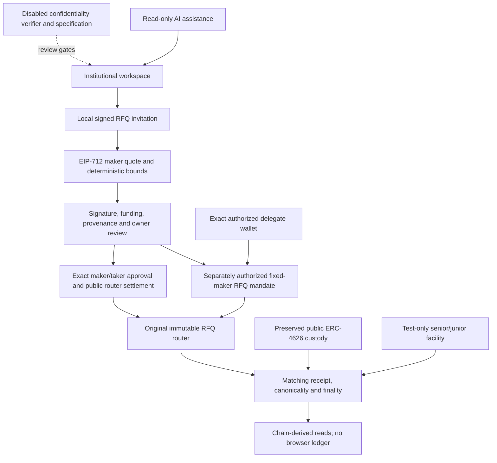

# Kudex RFQ-first product restoration — October 29, 2026

This is implementation evidence and an internal review, not an independent security audit.
Repository: `Oluwa-Laughter/kudex`; existing local branch `main`.
Starting HEAD: `0a09d66` (integrity report), following implementation `58b6170`.
`git fetch origin main` established that local main was two commits ahead and zero behind;
no remote work was overwritten. The initial `next-env.d.ts` development-route import
change is preserved outside the commits. Work was confined to this repository and its current requirements.

No push, public deployment, live configuration import, real-fund transfer or mainnet
transaction occurred. `.env.local` was not edited. KTEST remains unbacked test collateral.
The existing native Portaldot signing preference is preserved; no EVM key is inferred
from SS58/H160 mapping. All financial signatures in integration tests use isolated child
Anvil accounts, never a public funded signer.

## Local commits

- `ce4536e` — bounded RFQ executor, test credit waterfall, adversarial/invariant tests,
  runtime diagnostic contracts/scripts and unsigned artifact review.
- `16b454d` — restored institutional product/RFQ frontend, invitation/provenance/receipt
  boundaries, mandate UI, local browser journeys, decoder compatibility fix and CI.
- This documentation/evidence commit records measured results and remaining gates.
  All remain local; no push or integration merge was performed.

## What was wrong and what changed

The previous integrity round had already removed browser-ledger balances and simulated
financial success. That work was preserved. However, the primary marketplace still led
with an unavailable AMM and relegated the working RFQ interface to an advanced route.
Navigation and metadata still framed the product around swaps/fleets. More seriously,
both the AI system prompt and deterministic fallback advertised nonexistent AMM swaps,
structured tranches, ramps and autopilot execution.

The marketplace at `/app/marketplace` now leads with **Create an RFQ**, quote creation,
review and public atomic settlement. `/app/rfq` remains compatible. Overview presents
institutional tasks rather than invented portfolio totals. Navigation follows settlement,
RFQ, credit/RWA, agents, risk/DaaS, compliance and activity. Infrastructure and bridge
status sit outside the primary financial journey. Homepage, marketplace marketing,
assistant prompts/fallbacks, quickstart and guides follow the four-pillar thesis.

The premium Sora/DM Sans, emerald/slate, light/dark system remains. Mobile and desktop
screenshots are retained in `screenshots/restored-rfq-{mobile,desktop}.png`. The new
accessibility probe caught a wallet-button visible/accessible label mismatch; it was
corrected. Unsupported confidentiality and investment functions remain unavailable.

## Delivered architecture

The AI has no signing or transaction tool and cannot grant policy authority. Off-chain
quotes do not imply private on-chain settlement. New agent authority is isolated in a
new immutable executor; it is not added to the original deposit-only executor.

## RFQ invitations and settlement

`src/lib/contracts/requests.ts` specifies EOA-signed invitation envelopes bound to a
separate EIP-712 name/version, chain, router, requester, named solver, asset pair,
minimum receipt, maximum payment, deadline and nonce. Import is size/schema/range
bounded; signatures, domain and expiry are checked. Quotes are compared deterministically
against the invitation, requester, pair, maker, amounts and deadlines. The UI signs a
one-hour invitation and exports it locally; no request API, public feed or private
order database was invented. A named solver is not independently qualified by this code.
EOA invitation support does not replace preserved EIP-1271 quote-maker support.

**Important limit:** invitation nonces identify signed documents; there is no durable
request replay/cancellation service. Invitations are not accepted orders or allowances.
The original v1 router remains a bearer, public, full-fill router: any holder of a
maker signature can fill it. Naming a requester/solver does not add taker restrictions
to that router. Cancelling a maker nonce is on-chain and separate from an invitation.
A future exclusive quote format needs a separately reviewed signed taker/domain upgrade.

The shared RFQ execution boundary now requires reviewed router and asset runtime pins
before quote signing or financial writes. Asset pins are bounded to 32 entries. The
verified deployment importer records the router code pin; additional assets still need
independent provenance/economic review. Pins do not authenticate proxy implementations
or make malicious/rebasing collateral safe. Allowance removal remains separately available.

Approval, cancellation and fill receipts require exact transaction hash, sender,
destination and matching source/event/arguments. Canonical block verification and the
actual finalized tag distinguish confirmed/finalized/unknown states. No 12-block display
heuristic is used as finality for execution. Token metadata/state refreshes from chain.

The RFQ review stores only deployment/account-scoped submitted references in
sessionStorage, not quote signatures, balances or settlement success. Failed/ambiguous
reconciliation retains the action lock. This is not a durable journal: storage loss,
new tabs/devices and replacement/pruned receipts need further reconciliation service.
The mandate panel retains pending evidence only while mounted and explicitly warns
about reloads. No blind automatic transaction retry is implemented.

## Bounded RFQ authority

New `contracts/src/KudexRfqExecutor.sol` fixes its router at construction. A policy fixes
owner, delegate, maker, buy/pay assets, expiry, rational minimum receipt/payment rate,
per-action payment cap, UTC-day cap and total cap. All limits use specified token base
units. Required receipt is `ceil(payment * minimumBuy / referencePay)`; this is not a
USD oracle, rolling 24-hour cap or unconditional monetary-loss bound.

Only the delegate can call the one RFQ operation. Spending is consumed before external
work and reverted atomically on failure. Exact owner funding is pulled temporarily;
router allowance is exact and cleared; received tokens return to the policy owner;
executor inventory must return to its prior balances. No arbitrary target, selector,
recipient, withdrawal or key custody is introduced. The owner can revoke at any time;
remaining allowance removal is separate. Maker nonce/signature/cancellation rules remain
in the original router. An immutable reviewed router and exact-transfer assets are
security assumptions, not economic claims.

The new RFQ mandate tab supports creation, observed policy/budget inspection, owner
allowance/removal, delegate quote simulation/execution, receipt reconciliation and
revocation. Default executor address/hash configuration remains blank. The browser
journey proves manual policy-enforced trading on local compiled contracts. It does
not establish background autonomous execution or current native-wallet signing.

## Credit and DaaS

New `KudexTestCreditFacility` is restricted to chain 420420777 and models unbacked,
zero-interest senior/junior principal. Fixed administrator, borrower, document reference,
tranche targets and funding/maturity/grace terms precede permissioned subscriptions.
Only fully funded capital disburses once to the borrower before the cutoff. Failed
or undistributed raises refund individual subscriptions after the cutoff. Investor
eligibility revocation cannot seize an existing claim or refund.

Actual repayment R allocates min(R,S) to senior and max(R-S,0) to junior, using cumulative
proportional integer claims minus prior payments. Repayment cannot exceed total principal.
No investor loop is required. Rounding dust remains in custody and cannot be swept by
an administrator. At maturity+grace unpaid active debt may be publicly classified as
defaulted. Actual recoveries follow the same waterfall; full repayment ends the debt.
No default declaration invents cash or seizes an off-chain asset.

Conservation without donations: after disbursement `cash + totalClaimed = repaid <= S+J`;
failed funding `cash + totalRefunded = seniorFunded + juniorFunded`. Donations do not
increase investor allocations. These are tested financial invariants, not assertions
of issuer creditworthiness, legal backing, servicing or regulatory clearance.

Portaldot runtime metadata exposed an account `recovery` candidate with friend/inheritor
account recovery methods. It did not establish a callable credit DaaS court/liquidation
interface. No verified external DaaS address, ABI, permissions or reversal semantics
were obtained. The original local risk/freeze adapter is preserved and not relabeled
native recovery. The frontend lists no investable facility. See `CREDIT_AND_DAAS.md`.

## Confidentiality progress and precise limits

Read-only inspection confirms runtime `portaldot-v3` 3002, chain 420420777, genesis
`0xd4f9acbcf7f52388d8b095abe3c198d19fc510e0343e643e87cfbccb155283bd`, native
14 decimals, EVM 18 decimals and EVM bytecode enabled. An inspection timed out before
a successful retry; RPC failure is not converted into a healthy state.

At block **242074**, the ephemeral `CryptoProbe` constructor passed BN254 addition,
scalar multiplication, nonidentity pairing, cancelling pairings and malformed-point
rejection. Direct RPC probes had failed with `Invalid call: Payment`; those failures
are retained separately and are not proof of absent pairing support. Known answers
follow EIP-196/197, not a mock verifier. `PORTALDOT_CRYPTO_PROBES.json` records the hash.

BN254 Groth16 is now an evidenced candidate, not an activated proof system. The
confidentiality specification defines candidate note/domain fields, membership,
nullifiers, range/conservation constraints, public recipient/fee bindings, root history,
recipient discovery/recovery, viewing scopes and metadata threats. No reviewed circuit,
trusted setup, proof artifacts, encrypted note wallet or independent proof vectors were
delivered. The existing verifier and confidential-transfer entry point remain disabled.
A public deposit or commitment is not a private commercial payment.

At block **242203**, a second ephemeral constructor diagnostic exercised the new RFQ
policy/exact transfers/allowance cleanup/revocation and test credit subscription,
repayment, seniority and claims on the actual runtime. `PORTALDOT_RESTORATION_SMOKE.json`
contains block and creation-code hashes. Both diagnostics used read-only `eth_call`
with a temporary caller-balance override. No asset, contract or receipt was published.

## Tests and evidence

Baseline reproduction: 24 Node tests and 50 Foundry tests passed before the restoration.
Final evidence below is local unless explicitly identified as read-only Portaldot.

| Command | Actual result |
| --- | --- |
| `pnpm typecheck` | Passed strict TypeScript |
| `pnpm build` | Passed production build/routes |
| `pnpm test:ui` | 9 passed; preserved 7 plus mobile/desktop RFQ navigation, unavailable states and axe serious/critical checks |
| `pnpm test:rfq-ui` | Passed real local browser invitation/quote signatures, exact two-sided approvals, fill/balances, RFQ mandate authorization, delegate execution and revocation |
| `pnpm test:vault-ui` | Passed preserved local browser deposit, receipt/share refresh and full redemption |
| `forge test --root contracts --summary` | 67 passed, 0 failed/skipped; 50 preserved plus 17 new tests/suites |
| New stateful invariants | RFQ budget/custody and credit backing: 256 runs and 128,000 calls each, zero reverts; preserved vault invariant also 128,000 calls |
| New adversarial/unit/fuzz cases | 9 RFQ executor and 6 credit cases; rounding-up price floor, caps, expiry, revocation, cancellation/replay, bad signatures, taxed legs, refunds, multiple investors and eligibility revocation |
| Node network/deployment/policy/service/RFQ/vault suites | 27 passed, including 7 RFQ envelope/receipt/provenance cases |
| Compiled local Node integrations | 3 passed: direct RFQ, separate delegate RFQ (also ABI equality), vault round trip |
| `pnpm test:dependency` | Passed actual transitive CommonJS query-string API, ESM parity/source equivalence and adversarial decoder fixture |
| Frozen pnpm install | Passed with checked-in patch and synchronized lockfile |
| Production audit at high threshold | Exit 0; two moderate findings remain, not a clean audit |
| Scoped changed-source Prettier / `git diff --check` | Passed; no repository ESLint command is configured |
| `pnpm inspect:portaldot` | Actual runtime metadata/identity observed; first timeout retained as a failure in this report |
| `pnpm probe:cryptography` | Five actual-runtime primitive checks passed, read-only |
| `pnpm test:restoration-runtime` | Actual-runtime ephemeral RFQ policy and credit accounting assertions passed, read-only |
| Offline deployment manifest preparation | Actual artifact hashes/constructor schemas, no signer/addresses/transactions |

Logs are retained under `docs/verification/`, with terminal control characters and whitespace normalized. Foundry gas reported per **test** is not
an operation-level or production throughput benchmark. No prover performance or proof
verification benchmark is claimed. Existing optional dependency peer/version warnings,
Node localStorage/module-type warnings and Foundry lint/submodule-layout warnings remain;
compilation and required tests pass despite them. No detector, test or CI job was disabled.
No independent static/cryptographic audit of the new contracts is claimed.

During development, tests genuinely caught a Solidity stack-depth limit (factored asset
settlement), a Foundry expectation placed before a signature hash read (corrected test
ordering), signed-export label accessibility, a React ref typing issue, and a dependency
patch that omitted its new CJS file. The first accessibility run failed two cases before
the label fix. These are recorded as corrected failures, not passing early checks.

## Dependency and CI changes

A new audit found one high URL-decoder advisory in the optional WalletConnect graph.
The fixed upstream decoder changes CJS to ESM. The targeted upgrade to 0.5.1 includes
a hash-bound pnpm patch adding a CJS build of the exact fixed upstream algorithm and
conditional exports, tested through the real transitive query-string consumer. No
custom decoder or cryptographic dependency override was introduced. An offline install
attempt lacked cached registry metadata; a subsequent normal/prefer-offline install and
frozen install passed. Two moderate UUID findings remain. WalletConnect mobile/vendor
acceptance is not established by an injected Anvil wallet.

CI now includes dependency API compatibility and the new real-contract RFQ browser
journey. Existing network, policy, RFQ, vault, build, browser, contract and high-audit
checks remain. Workflow source was reviewed locally; no new remote Actions run is
claimed because nothing was pushed. See `DEPENDENCY_RESTORATION.md`.

## Changed files and deployment status

Contracts/tests: `KudexRfqExecutor.sol`, `KudexTestCreditFacility.sol`, their unit tests,
`KudexProtocolInvariants.t.sol`, `CryptoProbe.sol`, `RestorationSmoke.sol`. Existing vault,
RFQ router, deposit executor, registry, adapter and fail-closed verifier source is unchanged.

Client/UI: RFQ request builder/workspace/review, signed request and execution helpers,
RFQ mandate panel and compiled ABI; removal of the unused fictional token catalog; primary overview/navigation and new activity/credit/
infrastructure routes; assistant instructions/fallbacks; marketing and wallet label.

Tooling: read-only runtime/crypto inspection, offline manifest, router provenance import,
compiled/browser/compatibility tests, workflow, decoder patch and lockfile. Documentation
updates preserve prior reports as historical evidence. No hosted API, solver, database,
worker or private disclosure service was represented as implemented.

The unsigned review manifest includes both extensions but existing broadcast scripts
were not expanded to publish them. Signer, collateral, constructor arguments, deployed
addresses and transaction evidence remain unresolved. No live addresses were invented;
blank executor/hash/sample configuration is preserved. The manifests are artifacts,
not receipts. No fee module or proposed commercial charge was activated.

## Remaining work, in dependency order

1. Independently review new RFQ authority, token behavior, cumulative waterfall/rounding,
   defaults and fixed terms. Evaluate pause/emergency/operational roles and appropriate
   legal rights before any financial facility activation. No real funds.
2. Review KTEST, exact constructors, owners, native signer capabilities, gas/storage
   funding and final unsigned plan. Obtain separate deployment authorization; verify
   finalized receipts, deployed code including immutables and roles before importing
   any live market. Execute full funded testnet browser journeys afterward.
3. Authenticated private RFQ inbox/solver identity, tenant access, durable request
   nonces/cancellation/retention, exclusive taker quote version where needed, persistent
   transaction journal and reorg-aware indexed history. Exported invitations are not this.
4. Secure durable RFQ worker: authenticated jobs, per-policy and per-signer serialization,
   nonce/replacement/unknown-state handling, finality/reorg recovery, revocation, fee/gas
   bounds, emergency stop and monitoring. Manual delegates are not autonomous workers.
5. Freeze/review note/circuit fields and hash/key primitives; reproducible setup/artifacts,
   independent positive/negative proofs, Merkle/nullifier custody, user-controlled encrypted
   recovery/discovery/disclosure, actual runtime verification and prover measurements.
   Keep privacy disabled until all cryptographic gates pass.
6. Verified issuer/asset rights, servicing, schedules and legal/default authority for credit;
   durable facility indexing and frontend activation only after reviewed test deployment.
   Obtain actual DaaS contract/runtime interfaces before any native integration claim.
7. Resolve moderate wallet advisories and manual wallet/device coverage; independent audits,
   distributed limits, monitoring and incident procedures before broader custody use.

The next substantial product milestone is authenticated, durable counterparty RFQ
communication and receipt reconciliation around the now-restored settlement workflow,
paired with a separately authorized native testnet activation plan. Confidential
settlement remains a parallel cryptographic engineering program, not a dashboard toggle.
