# Kudex engineering review — 2026-10-28

Current RFQ-first direction, capability inventory and release gates: [October 29 restoration](ENGINEERING_RESTORATION_2026-10-29.md). Earlier AMM priorities below are historical and superseded.

This is an internal implementation review, not an independent audit. Integration target: `main` in `Oluwa-Laughter/kudex`. The clean checkout was pulled with `git pull --ff-only origin main`; source reviewed: `e817ca7312720c5ead19854d22b3686e48f2ce01`. No push, external deployment, or public financial transaction was performed.

## Initial findings and root causes

Recent commits `0ba65f5`, `aea4427`, and `e817ca7` shifted the frontend from signed RFQ to AMM/fleet demonstrations without implementing AMM contracts. Existing RFQ, policy and network modules remained in the repository but were partly disconnected.

The financial source of truth had moved into persisted Zustand `kudex-protocol-v5`: swaps mutated local balances, generated abbreviated random hashes and marked orders filled; LP issuance used a local square root and fixed ownership; vault deposits/withdrawals used local tranche balances; fleet runs incremented local volume. The bridge generated synthetic settlement records. The wallet dialog substituted `500.00 tPOT` when native RPC data was absent. Marketing advertised invented TVL, volume, APY and principal guarantees. An unused generative RFQ card also sent a hard-coded selector without signed offer data and treated submission as execution.

GitHub run [40330640807](https://github.com/Oluwa-Laughter/kudex/actions/runs/40330640807) was inspected through the GitHub connector, including job logs: contracts, web unit tests, local RFQ integration and build passed; all four Playwright tests failed. Causes were renamed wallet/policy controls, a hidden assistant tab, and an RFQ test still targeting the replaced marketplace. The dependency audit had never run because it followed the failed browser step.

## Capability inventory after changes

| Frontend / feature | API / data | Wallet boundary | Contract / lifecycle | Evidence and status |
| --- | --- | --- | --- | --- |
| Overview / readiness | Direct chain reads and `/api/protocol/events` | Separate native and EVM accounts | Code presence and network identity; bounded recent event observations | Real observations; no browser ledger or invented USD portfolio |
| Native account | `/api/portaldot/account` → runtime address mapping and finalized account state | Injected native account identification only | No native signing in the transaction UI | Runtime inspection verified; browser identity/failure fixtures tested |
| Public vault | Shared `readVault`, ERC-20 metadata and same-block ERC-4626 reads | Exact connected EVM owner | Separate exact approval, bounded deposit/redeem simulation, signature, receipt identity + event validation, canonical/finalized check, refreshed shares | Local compiled-contract and browser round trips pass; public deployment pending |
| Swap / liquidity | No verified AMM integration | Disabled | No pool/router/LP deployment verified | Explicit unavailable state; no fictitious prices/reserves/APR/positions |
| Advanced RFQ `/app/rfq` | Signed export parser + direct router/token reads | Exact maker/taker EVM wallets | EIP-712/ERC-1271 verification, nonce, separate approvals, full fill, matching event, cancellation | Existing useful contracts preserved; local settlement/replay test passes; public deployment pending |
| Agent assistant | `/api/chat`, `/api/agent/status`, bounded read tools | No signer access | No model custody or autonomous execution | Google SDK mock-provider and streaming browser tests pass; real model availability depends on server configuration |
| Agent policies | Direct registry, governance, executor and policy reads | Owner creates/revokes/approves; exact delegate deposits | Deposit-only executor caps action/day/lifetime/expiry; registry revocation; matching creation/revocation/execution events checked | Contracts and UI integration implemented; deployment/funding required |
| Fleet | No durable worker | Activation disabled | No job queue, nonce manager or reconciliation service | Unavailable; no synthetic active bots, deployments or profits |
| Risk | `/api/protocol/vault` | Owner score; authorized sentinel/controller | Adapter freezes deposits at configured threshold; no debt recovery | Administrative input explicitly labeled; no inferred health or investor guarantee |
| Privacy / settlement | Unavailable | Disabled | `confidentialTransfer` reverts; verifier fail-closed | Preserved, tested; public deposits are not confidential |
| Bridge / disclosure | Unavailable | Disabled | No bridge or disclosure protocol | Synthetic records/keys removed from UI |
| Indexer / activity | Bounded, cached recent scans only | Public reads | Twelve-block display lag is not finality | No durable database/checkpoints/backfill or unified activity service yet |
| Tokenized credit | No facility module | Disabled | No issuer registry, repayment schedules, claims or loss waterfall | Roadmap only; unsupported financial claims removed |

## Implemented architecture

```mermaid
flowchart LR
    UI[Vault review UI] --> Reads[Same-block vault and token reads]
    Reads --> Check[Chain identity, asset relationship, bytecode provenance]
    Check --> Approval[Separate exact allowance signature]
    Approval --> Simulation[Bounded deposit or redemption simulation]
    Simulation --> Wallet[Exact EVM wallet signature]
    Wallet --> Receipt[Receipt identity and expected event]
    Receipt --> Canonical[Canonical block and finalized tag]
    Canonical --> Refresh[Refresh actual shares and assets]
    Wallet --> Recovery[Submitted reference, no success cached]
    Recovery --> Receipt
```

Browser storage never supplies ownership or success. The old ledger is no longer hydrated. Pending vault recovery retains only deployment-scoped hash and review terms; restoration locks execution until actual receipt reconciliation. It is a recovery reference, not a durable transaction journal or authority. RPC pruning, unavailable receipts, and ambiguous/replaced outcomes remain unresolved rather than successful. Clearing browser storage or using another device loses this recovery lock; a persistent account-scoped journal is still needed.

### Contract changes and implications

`KudexVault` adds `depositWithMinimum` and `redeemWithMinimum`: minimum output and timestamp deadline are enforced on-chain. Positive deposits that would mint zero shares revert. `_deposit` and `_withdraw` share reentrancy guards and reject inexact asset accounting, including taxed deposits and taxed recipient withdrawals. Standard ERC-4626 methods remain available; default still freezes new deposits and permits available withdrawals. Privacy remains disabled. Donation changes can still move share price; the bounded UI limits execution deterioration, and raw standard methods do not gain minimum-output protection. Unsupported malicious/rebasing tokens are not made safe by balance checks.

These changes require **a new immutable vault deployment**. They do not update old deployed code. RFQ, executor and policy registry contracts were preserved without widening delegate authority. The current agent executor still lacks a minimum-share output argument; independent review and a versioned extension are required before advertising automated investment strategies.

### Deployment provenance

The importer compares successful transaction creation input to compiled artifacts and exact constructor arguments, checks contract relationships and owner identities, and now requires canonical finalized receipt blocks. It writes runtime hashes for the vault and collateral. The vault UI checks those hashes before granting allowance or submitting deposits/redemptions; allowance removal remains possible without a provenance pin. Code presence is not source verification, and code-hash pinning is not an independent audit. External collateral still requires a separate provenance/economic review. Proxy or mutable assets are unsupported unless their full control model is reviewed.

### AMM decision

No reviewed Portaldot V3 AMM deployment and source manifest was established from the repository or public discovery during this session. This is not proof that none exists. Addresses from other chains were not reused. No native tPOT ERC-20 wrapper is assumed.

A custom AMM is a separate review workstream: allowlisted exact-transfer ERC-20 assets; immutable constant-product accounting; explicit initial-liquidity lock; integer reserve math; minimum output and deadlines; proportional LP mint/burn accounting; no price-oracle use; reserve manipulation and donation tests; adversarial token/reentrancy tests; stateful liquidity invariants; independent review before enabling UI spending. Factory/pool/token provenance, deployments, funded reserves, and real receipt verification precede quoting or trading. No custom AMM was represented as operational in this change.

## Live network evidence

Read-only commands on 2026-10-28:

- `NODE_USE_ENV_PROXY=1 pnpm check:network --rpc-only`: chain `420420777`, observed block `230218`.
- `NODE_USE_ENV_PROXY=1 pnpm inspect:portaldot`: genesis `0xd4f9acbcf7f52388d8b095abe3c198d19fc510e0343e643e87cfbccb155283bd`, spec `portaldot-v3`, version `3002`, native decimals `14`, ratio `10000`, EVM decimals `18`, `allowEVMBytecode: true`.
- `NODE_USE_ENV_PROXY=1 pnpm test:runtime`: passed at block `230296`; read-only `eth_call` with ephemeral assets, updated bounded vault, signed RFQ, replay/unsigned rejection, risk freeze, disabled privacy.

Node initially could not reach the endpoint without this environment's outbound proxy support; that was corrected without changing network identity. A successful `eth_call` does not publish bytecode, prove wallet signing, or establish public transaction finality. No funded signer was used. There are no new public deployment addresses or transaction hashes to report.

## Verification record

| Command | Result in this environment |
| --- | --- |
| `pnpm typecheck` | Passed |
| `pnpm build` | Passed; all application routes generated |
| Node test runner over network, deployment, agent-policy, agent-service, RFQ and vault-client suites | 24 tests passed |
| `pnpm test:rfq-runtime` | Passed: actual compiled local RFQ settlement, exact transfers and replay rejection |
| `pnpm test:vault-runtime` / equivalent Node invocation | Passed: compiled local vault approval, simulation, receipt events, shares, full redemption and provenance rejection |
| `pnpm test:ui` | 7 production-browser tests passed |
| `pnpm test:vault-ui` / equivalent script invocation | Passed: actual local browser deposit and redemption with chain assertions |
| `forge test --root contracts` | 50 tests passed, including 256 fuzz cases per fuzz test and 128,000 invariant calls with zero reverts |
| `pnpm audit --prod --audit-level high` | Exit 0; three moderate findings remain |
| `pnpm install --frozen-lockfile --ignore-scripts` | Passed; lockfile synchronized |
| `node scripts/prepare-deployment-manifest.mjs` | Offline unsigned review manifest generated from real compiled artifacts |

No updated remote GitHub run is claimed: changes have not been pushed. Required CI checks include `pnpm typecheck`, `pnpm build`, the existing network/deployment/agent/RFQ tests, new `pnpm test:vault`, `pnpm test:vault-runtime`, `pnpm test:vault-ui`, `pnpm test:ui`, `forge test --root contracts`, and `pnpm audit --prod --audit-level high`.

The offline manifest `contracts/deployments/420420777-unsigned-review.json` contains compiled creation-code hashes, compiler settings and constructor schemas. It explicitly contains no signer, collateral choice, addresses or transaction evidence. Resolve these fields and regenerate the exact deployment plan after signer/asset selection.

New contract tests cover bounded round trips, output-floor rollback, expiry, donation-induced zero output, unauthorized administration, taxed asset rollback, callback reentrancy rejection and a stateful accounting invariant. Browser regressions seed the legacy fabricated ledger and confirm it cannot resurrect financial data. They also cover missing native RPC data, mobile overflow, keyboard/focus, policy export, assistant streaming, and malformed RFQ offers. The local vault browser test uses an isolated child Anvil, compiled real contracts, real local transaction receipts and exact post-transaction reads. Its injected unlocked local signer is test infrastructure, not evidence that a particular hardware wallet or public Portaldot extension signing path works.

Dependency remediation upgrades Zod to 4.6.7 and overrides vulnerable transitive versions. High-severity audit findings are cleared; moderate `uuid` and `decode-uri-component` findings remain in wallet dependencies. Live WalletConnect/provider compatibility needs a manual device check; mocked browser wallet tests do not cover every wallet vendor. Existing optional React/TypeScript peer-version warnings also remain.

## Threat model and remaining release gates

| Threat | Implemented control | Remaining boundary |
| --- | --- | --- |
| Fake execution / stale browser ledger | Remove ledger consumers, synthetic hashes and financial mutations; require receipts/events | No durable account journal; browser references can be lost |
| Wrong chain / wrong vault / wrong token | Chain identity, bytecode pins, asset relationship, exact owner signatures | RPC remains trusted; external asset source and upgrade authority review required |
| Excess approval / double submission | Exact approval; separate removal; action lock; pending receipt reconciliation | Cross-device locking, replacement cancellation UX and durable worker serialization pending |
| Rounding / price movement | BigInt amounts, precision bounds, minimum output and expiry | ERC-4626 donations and unsupported asset behavior require review |
| Reentrancy / inexact token transfers | Common guarded asset transfer hooks; rollback tests | Independent audit and broader malicious-token suite remain |
| Agent authority escalation | Deposit-only immutable executor, explicit owner/delegate, caps, expiry, revocation, event checks | No durable worker; executor minimum-share guard absent; manual controls need durable unknown-state journal |
| Model/tool injection | Existing bounded schemas, same-origin request guard, limited read tools; no signing keys | Distributed rate limiting and private operational auth pending |
| False privacy / fabricated investment rights | Verifier and transfer remain disabled; remove privacy/yield/principal claims | Cryptographic review, legal/issuer/collateral design needed before future activation |
| Chain reorganization / pruning | Receipt canonicality and actual finalized tag; unavailable history remains error | Persistent reorg-aware indexer, archive provider and transaction reconciliation service pending |
| Governance misuse | Existing timelocked registry design; immutable vault custody | Operator multisig/keystore procedures and emergency monitoring need deployment review |

Next dependency order:

1. Review the vault diff and collateral; select an explicitly authorized funded testnet signer. Prepare constructor manifest for that identity. Authorize publication separately. Run deployment, verify finalized receipts/code/owners, import configuration, rebuild, and exercise funded deposit/redemption on Portaldot. No mainnet actions.
2. Obtain reviewed AMM deployment/source/asset manifests from the network team, or complete the narrow custom-AMM review workstream. Implement quotes, slippage/deadline execution, LP accounting and actual funded testnet swaps before enabling the workspace.
3. Add a persistent database, chain-scoped journal and reorg-aware event indexer: deployment checkpoints, bounded backfills, hash tracking, deduplication, finality, rollback, restart and health. Serve paginated activity and positions from reconciled projections, with contracts authoritative.
4. Build authenticated durable deposit-only jobs with idempotency, per-account nonce management, per-policy serialization, revocation checks and receipt/replacement recovery. Do not auto-retry a financial submission. Extend the executor with reviewed minimum-share restrictions before scheduled deposits.
5. Independent contract review, moderate dependency remediation, live wallet coverage, incident runbook, monitoring, distributed limits and access-control review before broader custody use.
6. Develop one legal/economic testnet credit facility. Privacy, disclosure and bridging remain separately reviewed future modules.

The full requested product acceptance criteria are **not yet met**: no public funded vault transaction, verified AMM swap, deployed agent authorization, durable indexing or autonomous worker is demonstrated here. Milestone A integrity and CI repair and substantial Milestone B implementation are delivered with local and read-only runtime evidence. Later capabilities remain explicitly unavailable.

## Main changed implementation files

- `src/lib/protocol-store.ts`: retired ledger API; no financial persistence or mutators.
- `src/components/dashboard/PublicVault.tsx`, `src/lib/contracts/vault-client.ts`, `src/lib/contracts/pending-vault.ts`: exact review/execution, provenance, chain reads, receipt checks and submitted-reference recovery.
- `contracts/src/KudexVault.sol`, `contracts/test/KudexVaultIntegrity.t.sol`, `contracts/testnet/RuntimeSmoke.sol`: bounded custody operations, common guarded transfer hooks and adversarial/stateful/runtime tests.
- `scripts/configure-deployment.mjs`, `scripts/prepare-deployment-manifest.mjs`, `.env.example`: finalized artifact import, runtime hash pins and unsigned preparation.
- `src/app/app/*`, `AgentFleetManager`, `AgentWorkspace`, `ConnectWalletButton`, `RFQQuoteCard`: truthful availability, restored advanced RFQ, actual wallet balances and preserved signing boundaries.
- Marketing routes and shared guides: unsupported guarantees and fabricated telemetry removed; roadmap clearly labeled.
- `tests/browser/*`, `tests/vault-*.mjs`, `tests/local-vault-ui.mjs`, helper and CI workflow: repaired interactions, financial-integrity regressions and compiled-contract browser verification.
- `package.json`, `pnpm-lock.yaml`: patched validation dependency and required verification commands.

Implementation commit: `58b6170` (`fix: replace simulated finance with receipt-verified vault execution`). See `git show --stat 58b6170` for the complete file list. Documentation is committed separately so its evidence and release gates are reviewable alongside the code.
