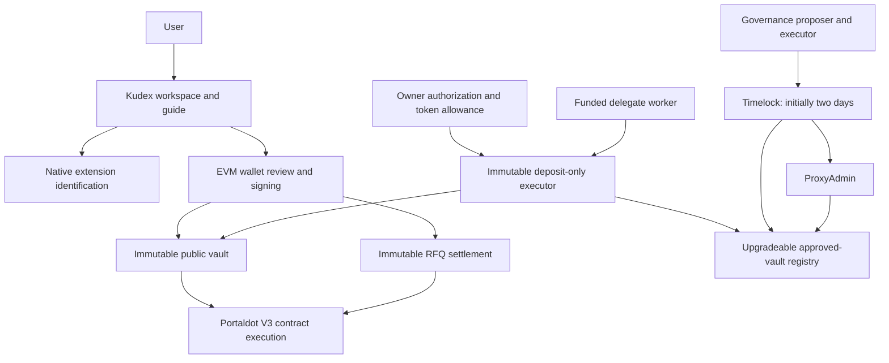

# Kudex product scope

## Product and track fit

Kudex is a financial application: public vault custody, signed RFQ settlement, bounded delegate execution, and a longer-term direction toward confidential settlement and structured credit. Based on this scope, DeFi / financial infrastructure / RWA is the closest track **if present in the actual registration form**. The organizer's validator-monitoring response does not describe Kudex's current functionality. No official track list has been verified in this repository, so do not claim an official selection or invent validator features to fit that response.

## Demonstrable first release

One truthful core journey is more useful than a menu of simulated financial results:

1. Identify the native wallet and explain funding/signing boundaries.
2. Check the verified Portaldot V3 testnet and deployed contract configuration.
3. Review a public vault deposit, approve the exact collateral amount, and confirm a receipt.
4. Read balances from the chain and withdraw available assets.
5. Prepare and export a bounded agent policy without claiming it is active.

The first four steps require the relevant funded signing account and verified deployments. Native identification can be tried with the actual extension; native in-app transaction signing is pending. Core contract behavior has a live read-only runtime smoke test, but this is not deployment evidence.

## Delivery sequence

- **Current:** UI and onboarding, public vault transaction flow, signed RFQ contract, fail-closed privacy verifier, risk freeze controls, native account identification, agent policy drafts, deposit executor and timelocked registry code/tests.
- **Testnet activation:** funding, core deployment, verified manifest, actual wallet-flow acceptance, then separate agent infrastructure deployment and timed vault approval. Do not expose unverified addresses as activated.
- **Reliable agents:** transaction journal, idempotent jobs, per-policy queue, receipt reconciliation, worker signer operations, alerting and revocation monitoring. Add hosted automation only after these controls exist.
- **RFQ product:** direct maker signing/export, imported-offer review, exact approvals, full-fill simulation/receipt confirmation, cancellation and allowance removal are implemented in the app. Activation requires deployment and funded wallet acceptance. Next are authenticated solver onboarding, a signed quote API, durable order storage, and indexed reconciliation.
- **Private settlement:** reviewed circuit, proving setup/artifacts, note recovery, membership tree, nullifier/value conservation/domain checks, withdrawal path and independent security review.
- **Structured credit:** asset/legal origination, accounting, servicing, waterfall implementation and risk evidence before marketing returns or protection.

## Scaling gates

Public RPCs should not be an unbounded per-browser indexer. Before growing usage, move event ingestion to a durable indexer with deployment-block checkpoints, bounded/adaptive log windows, chain finality handling, deduplication by block hash/transaction hash/log index, rewind/reconciliation, and backpressure. Store derived state in a queryable database and serve paginated, cached APIs; preserve raw integer quantities. Do not infer finality from a fixed 12-block lag.

Worker scaling requires one serialized execution lane per policy/signer plus global nonce management; replay-safe jobs and an uncertain-submission state prevent duplicate authorized deposits. Shared rate limits, RPC timeouts, failure budgets, and service metrics should be measured before adding concurrency. The current manual one-shot runner has no automatic retries.

Add throughput targets only after measuring real RPC limits, block inclusion, fee/storage costs, and confirmation latency on the target network. Portaldot's architectural capacity is not evidence of Kudex application throughput. No load-test or production scale certification is claimed.

## Check-in artifacts

- README and current scope: this repository.
- User walkthrough: `public/kudex-quickstart.md`, `/how-it-works`.
- Architecture: diagram below.
- Prototype: deployed UI URL after browser verification and hosting.
- Network evidence: actual receipts and addresses after funding/deployment. Until then, label runtime smoke calls as read-only diagnostics.
- Demo: at most three minutes if the organizer's provided instruction still applies. Show one complete vault journey, one policy draft, and state what remains pending.

## Second-pass implementation

The agent now has optional Google AI Studio conversation with bounded read-only tools, streamed responses and tool progress, live native-account inspection, and wallet-driven policy authorization/lifecycle controls. See [Agent setup](AGENT_SETUP.md). Google credentials/model configuration and funded contract deployments remain activation prerequisites.

Event scanning now runs behind a shared server endpoint with a bounded recent window, bounded request chunks, exact integer totals, and short per-process caching. This reduces duplicate requests from browsers sharing an instance. It does not replace the durable indexer/database and global rate limits described above.

## Product-focused RFQ slice

Kudex remains a settlement and credit product. Testnet diagnosis supports its deployment; it is not the product category. The latest UI puts capital, signed offers, and agent permissions first. The marketplace now has a direct signed-offer workflow; pool protection reads actual configured vault state; pricing is an explicitly proposed model. See [RFQ settlement](RFQ_SETTLEMENT.md). Private settlement, credit accounting, bridging, disclosure, and hosted autonomous execution remain substantive engineering work, not features supplied by a model key.
