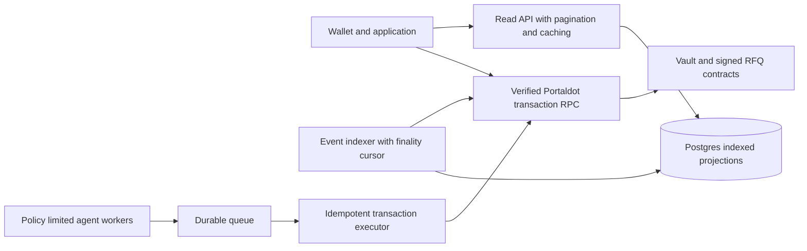

# Kudex implementation and scaling review

Current RFQ-first direction, capability inventory and release gates: [October 29 restoration](ENGINEERING_RESTORATION_2026-10-29.md). Earlier AMM priorities below are historical and superseded.


Current inventory, October 28 fixes, test evidence and release gates: [engineering review](ENGINEERING_REVIEW_2026-10-28.md). Earlier dated observations below are historical. The AMM workspace remains at `/app/marketplace`; signed RFQ is now `/app/rfq`.

Initial review date: 2026-10-16. This document records the initial review; sections describing the then-disabled agent and unavailable browser are historical. Current agent behavior is in [Agent setup](AGENT_SETUP.md), current signed-offer UI in [RFQ settlement](RFQ_SETTLEMENT.md), and current network configuration in [Portaldot activation](PORTALDOT_TESTNET.md). This is an internal engineering review, not an independent security audit or production certification.

## Product and track

Kudex's intended product is a settlement application for tokenized credit and agent participants on Portaldot. Its scope belongs with DeFi/RWA or financial infrastructure if those categories appear on the actual registration form. The supplied validator-monitoring mentor reply does not describe the current repository. Exact official track names remain unverified; do not claim a confirmed registration.

Keep the long-term scope, but release in vertical slices that can be demonstrated and verified. Adding marketing sections does not add protocol capability.

| Capability | Repository reality after this review | Release prerequisite |
| --- | --- | --- |
| Public vault | ERC-4626 deposit, mint, withdraw and redeem; app deposit/withdraw integration | Verified network, collateral and deployment; live wallet testing |
| RFQ settlement | Signed EIP-712 orders, one-use maker nonces, cancellation, atomic token transfers | Solver quote service, signing UX, exact approvals, deployed router |
| Risk monitoring | Owner-provided score; authorized adapter can freeze new deposits | Oracle/risk source, operational sentinel, governance policy |
| Private settlement | Disabled; the old verifier was not a Groth16 verifier | Note circuit, membership tree, conservation constraints, reviewed generated verifier, wallet recovery and redemption |
| RWA tranches | Not implemented | Asset registry, issuer permissions, credit accounting, debt servicing and loss waterfall |
| Agent economy | Not implemented | Policy executor, authenticated services, spend accounting and revocation |
| Bridge | Not implemented | Chosen provider, real escrow/message verification, finality and refund handling |
| Selective disclosure | Not implemented | Privacy scheme with tested auditor disclosure and encryption |

Unimplemented workflows show explicit unavailable states. The agent endpoint now supports configured Google conversation and bounded live reads. Browser storage is not evidence of asset ownership or policy authorization. Old persisted simulated records are no longer loaded.

## Security findings and changes

| Severity | Finding in original source | Remediation |
| --- | --- | --- |
| Critical | RFQ ignored the signature argument. A caller could choose a maker's approved tokens and arbitrary amounts. | OpenZeppelin EIP-712 and SignatureChecker; domain binds chain and deployment. EOA and ERC-1271 validation supported by library. |
| Critical | Pairing-only verifier omitted a circuit verification key and did not bind statements. Confidential transfer accepted arbitrary unbound public inputs. | Verifier returns false; confidential transfer disabled even with a permissive verifier. No claim of implemented privacy. |
| High | Standard ERC-4626 deposit/mint bypassed the default check in shieldDeposit. | maxDeposit/maxMint return zero during default. Withdrawals remain available. |
| High | Unverified default contract/token addresses could direct wallet actions to unrelated deployments. | Removed default addresses; explicit configuration, chain identity, code and vault asset checks before vault actions. |
| High | Local fallbacks fabricated successful orders, notes, withdrawals and agent policies. Submitted hashes were treated as completion. | Removed simulated app workflows; deposit/withdraw state comes from RPC and successful receipts. |
| High | Adapter could not trigger default without owning the vault; ownership transfer removed practical risk administration. | Separate revocable default-controller role; deploy script wires adapter while retaining owner administration. |
| Medium | Reused commitments and zero commitments accepted. | Reject duplicates and zero commitment. This does not make deposits private. |
| Medium | Reusing a nonce with modified signed orders could allow multiple settlements. | A maker nonce is consumed on the first successful fill. |
| Medium | Error path returned healthy zero statistics; gas and timeframes were invented. | RPC errors remain errors; bounded event window and actual token decimals; removed guessed gas and inactive range controls. |
| Medium | Four-digit timestamp IDs collided and persisted financial state crossed sessions. | UUIDs for draft records; no financial/policy persistence. Active screens no longer use the store as a ledger. |
| Medium | Debt restructuring/recovery events emitted without recovery. | Adapter emits DefaultEnforced for the operation actually performed. No debt recovery totals are fabricated. |

Remaining security work: independent contract review, invariant/stateful tests, adversarial token tests, multisig ownership and key procedures, wallet dependency advisory remediation, authenticated service threat modeling, and receipt/reorg/replacement tests in the browser. Fee-on-transfer, rebasing and malicious tokens are not supported collateral by default. Existing large allowances are not automatically revoked; the app creates exact approvals when additional allowance is needed. Simulation is not a reentrancy audit or proof of future execution.

Redeploy changed contracts. Old unsigned-order routers remain unsafe; updating frontend ABIs does not patch deployed code. The EIP-712 domain is `KudexRFQMarket`, version `1`; the schema is exported in `src/lib/contracts/orders.ts`.

## Original Portaldot integration gate (2026-10-16)

The endpoint, chain ID, runtime identity, EVM bytecode support and denomination questions below were subsequently verified. Current evidence, remaining wallet/deployment checks and commands are in [PORTALDOT_TESTNET.md](PORTALDOT_TESTNET.md). The following records the original audit context.

The user confirmed that the V3 RPC, chain ID, runtime methods, transports and local-node instructions are not verified. A mainnet announcement does not establish that an Ethereum RPC adapter is ready. No chain performance or successful Portaldot deployment has been measured here.

Ask the core team for:

1. V3 network identity: HTTP/WS endpoints, chain ID, genesis/runtime version and explorer for this exact environment.
2. Execution target: whether the runtime accepts solc EVM bytecode, resolc/PVM bytecode, or both; compiler versions and supported opcode/EVM target. The current Foundry Cancun build is a local EVM test target, not confirmed V3 deployment compatibility.
3. Ethereum adapter methods: eth_chainId, eth_call, eth_estimateGas, eth_sendRawTransaction, eth_getTransactionReceipt, eth_getCode, eth_getLogs, block queries, fee estimation, and replacement behavior. Confirm range, batch and rate limits.
4. Signing/accounts: EIP-1193 wallets, supported transaction envelopes and signatures, SS58/H160 account mapping, account/storage deposits and faucet funding procedure. An SS58 faucet requirement does not prove a native-to-EVM bridge exists.
5. Units: Substrate POT precision versus the Ethereum adapter's gas/value denomination; token contract decimals must be read independently.
6. Runtime capabilities: BN254/precompile support before choosing a proof verifier; EIP-1271 behavior; code-presence semantics; multicall availability. No assumed Multicall3 deployment remains.
7. Operations: finality signal, reorg handling, archive retention, CORS origins, WS subscriptions, RPC authentication and official deployment examples.

Read-only preflight after official configuration:

```sh
node --env-file=.env.local scripts/check-network.mjs
```

It verifies chain identity and deployed code; it does not certify contract behavior or V3 compatibility. Never send keys to organizers or embed a private key in NEXT_PUBLIC variables.

Sources consulted:

- [Portaldot developer documentation](https://portaldot-dev.readthedocs.io/en/latest/index.html): published Substrate/ink! interfaces; not a verified V3 EVM configuration.
- [Portaldot application engines](https://www.portaldot.world/protocol/modules/application-engines): describes an asset engine and access layer; does not establish Kudex integration or an RWA underwriting service.
- [Portaldot protocol](https://portaldot.world/protocol): product context for RWA, DeFi and agents, not evidence that Kudex integrates those services.
- [Upstream revive execution models](https://docs.polkadot.com/develop/parachains/customize-parachain/add-smart-contract-functionality/): documents solc/EVM and resolc/PVM paths. This is upstream context; Portaldot must confirm its enabled runtime configuration.

## Scaling architecture

Current implementation improvements: query keys include chain, RPC, deployment and wallet where appropriate; parallel independent reads; no assumed multicall; bounded 500-block event history, 100-block RPC chunks, at most two concurrent log queries, 30-second foreground refresh, incremental replay with a 12-block overlap and a 12-block observation delay. The delay is a conservative UI heuristic, not Portaldot finality. Deep reorganizations and a pruned provider still need a durable indexer. No lifetime or 7/30-day total is inferred from this bounded window.

Browser polling still scales linearly with open clients. These changes reduce RPC pressure but are not the production indexing architecture. Before public traffic:



Build the shared indexer once per network/deployment, not per wallet. Record chain ID, block hash, parent hash, transaction hash and log index; use a unique event constraint, checkpoint atomically with inserts, rewind on hash mismatch, and retain finalized/recent projections separately. Store quantities as exact integer strings or sufficiently sized NUMERIC columns, never JS floats. Scope positions by chain, contract and wallet. A browser cache remains disposable.

The read API should expose cursor pagination and observation metadata (indexed block, finality, lag). Cap page sizes and query costs; cache public aggregates centrally and make wallet-specific responses private. Enforce tenant/wallet authorization before introducing private reports. A public RPC proxy must allowlist methods and bound payload size, rather than accepting arbitrary upstream calls.

Agent workers need durable idempotency keys and transaction state transitions: proposed, user-authorized, submitted, confirmed, reverted or replaced. Persist a submitted hash before retrying; never blindly resubmit a transfer. The contract must enforce token/target/function allowlists, cumulative spend, expiry and revocation. Prompts and browser checks do not enforce policy.

Suggested initial service targets, to validate in load tests rather than advertise: paginated cached reads p95 under 500 ms, indexer lag within two finalized blocks, zero duplicate executions under worker retry, bounded RPC concurrency, and backpressure when queues or RPC error rates rise. Measure actual confirmation latency separately from API latency.

## Release sequence

1. Prove the public collateral vault: deployment identity, exact approval, deposit receipt, share balance, withdrawal receipt and failure recovery. Exit criterion: reproducible live testnet flow, plus insufficient balance, rejected signature and wrong-chain checks.
2. Add the solver service and order review UI around the secured RFQ contract. Exit criterion: valid signed fills, expired/cancelled orders, wrong domain and replay rejection with real receipts.
3. Implement one RWA facility before marketing tranches as live. Define issuer identity, asset evidence references, maturity, repayments, NAV source, allocation and loss accounting. Do not display credit grades or promised APYs without a source and product approval.
4. Implement bounded agents against the established vault/RFQ actions. Add worker recovery, executor policy and revocation tests before autonomous execution.
5. Add privacy as a separate audited subsystem. Protect secrets and note backup, implement membership/conservation and redemption, generate the real verifier, and test valid proofs. Random bytes plus public ERC-4626 shares do not provide confidentiality.
6. Add bridge and auditor disclosure only after choosing concrete providers and a tested privacy model.

Useful product additions after the first flow: a confirmed activity feed with replacement/reorg handling, transaction retry guidance, spending-permission review and revocation, indexed portfolio exports, issuer facility detail pages with evidence provenance, and per-action agent approval previews.

## Verification boundaries

Local Foundry tests exercise EVM behavior and include RFQ authorization/replay, default enforcement and the disabled privacy path. CI now runs contract tests, the web production build and a high-severity production dependency audit gate. No coverage percentage is claimed. The build establishes compilation, not wallet UX or Portaldot compatibility. Live end-to-end testing remains blocked on official V3 configuration and funding. The current environment exposes no browser for rendered visual verification.

## Dependency review

The initial production audit reported two high-severity advisories (jsondiffpatch prototype pollution and ws denial of service), five moderate and two low advisories. Unused `ai` and `@ai-sdk/react` packages were removed; they pulled conflicting major SDK versions and the vulnerable jsondiffpatch tree. An override upgrades vulnerable ws 8.x releases to 8.21.0 within the same major version. Wallet transitive advisories in uuid and decode-uri-component remain a release blocker pending a compatible upstream upgrade and wallet testing; forcing major versions without testing would not establish a safe integration. The package-registry audit is a point-in-time advisory check, not a code exploitability assessment.

Earlier local checks: 26 Foundry tests pass (including 256 fuzz cases for modified RFQ amounts); production build and TypeScript checks pass. The updated production advisory scan reports 0 critical, 0 high, 3 moderate and 0 low findings. The remaining moderate findings are in wallet transitive dependencies. These results do not establish Portaldot deployment compatibility or rendered browser correctness.

HTTP smoke checks against the local production server passed for the homepage and nine workspace routes, including the expected unavailable-deployment messages. POST /api/chat returned 503 with Cache-Control: no-store. These are response-content checks, not browser interaction tests.
